# Sheet Metal Connector 内部实现

_基础版开发说明，对应提交 `a4c55fc`，更新日期：2026-10-23。_

---

## 📋 范围与命名

Sheet Metal Connector 用一段带宽度和厚度的路径钣金连接两个模型 Face。界面和源码标识统一使用通用的 Sheet Metal Connector 名称。

当前实现包含 Face/Point 拾取、起点 Face 平面路线、圆弧折弯、每节点 Bend/Weld/BoltNut 过渡、预览、碰撞检查、XCAF 写入和当前文档内参数恢复。Auto Calculate 会拒绝发生碰撞的基础路线，但完整绕障搜索、原生文档持久化、展开及制造补偿仍不在当前范围内。

## 🏗️ 总体架构

```mermaid
flowchart LR
    accTitle: 钣金连接内部架构
    accDescr: 从交互拾取到路径规划、实体生成、碰撞检查、预览和 XCAF 写入的主要数据流

    ui[🖥️ WidgetSheetMetalConnector] --> face_geometry[📐 Face 几何]
    face_geometry --> model[📋 连接数据]
    model --> route_planner[🧭 路径规划]
    route_planner --> builder[🔧 实体生成]
    builder --> collision_checker{🔍 碰撞检查}
    collision_checker -->|通过| preview[👁️ 青色预览]
    collision_checker -->|违规| warning[⚠️ 红色预览]
    preview --> apply[✅ 应用实体]
    warning --> apply
    apply --> xcaf[(💾 XCAF 文档)]

    classDef input fill:#dbeafe,stroke:#2563eb,stroke-width:2px,color:#1e3a5f
    classDef geometry fill:#ede9fe,stroke:#7c3aed,stroke-width:2px,color:#3b0764
    classDef decision fill:#fef9c3,stroke:#ca8a04,stroke-width:2px,color:#713f12
    classDef output fill:#dcfce7,stroke:#16a34a,stroke-width:2px,color:#14532d

    class ui,face_geometry,model input
    class route_planner,builder geometry
    class collision_checker decision
    class preview,warning,apply,xcaf output
```

| 组件 | 职责 |
| --- | --- |
| `WidgetSheetMetalConnector` | UI 状态、拾取会话、预览、Apply/Clear 和数据传递 |
| `SheetMetalConnectorModel.h` | 端点、连接方式、折弯、路径和全局参数 |
| `SheetMetalFaceGeometry` | Face 内默认点、点投影和有方向的法向 |
| `SheetMetalRoutePlanner` | 起点 Face 平面路线、重复点删除和验收回调 |
| `SheetMetalRouteEvaluator` | 路径有效性、长度、折弯数和侧弯数统计 |
| `SheetMetalConnectorBuilder` | 圆角中心线、矩形扫掠和 Bolt/Nut 孔 |
| `SheetMetalObstacleMap` | 场景 Shape 提取、排除、允许接触裁剪和包围盒查询 |
| `SheetMetalCollisionChecker` | 包围盒初筛、精确干涉、间隙和允许接触区 |
| `ViewerWidget::displayShape` | XCAF 写入、显示注册和模型树集成 |

## 📍 Face 与 Point 拾取

Face 选择与 Point 选择承担不同职责。

### Face 选择

1. `startPicking()` 临时只启用 `TopAbs_FACE` 过滤器。
2. `onObjectSelected()` 取得子 Face 和父 `AIS_InteractiveObject`。
3. 将父对象 `LocalTransformation()` 与 Face Location 合成，保证 Face、端点、目标 Shape、预览和碰撞检查都使用世界坐标。
4. `centerPointAndNormal()` 通过 `BRepGProp::SurfaceProperties` 计算面积中心，再投影到底层曲面。
5. `BRepClass_FaceClassifier` 只接受位于裁剪 Face 内部或边界上的点。
6. 对带孔或凹形 Face，如果中心投影不在 Face 内，则在 UV 范围执行 `11 x 11` 采样，选择距离面积中心最近的有效点。
7. `GeomLProp_SLProps` 在有效点计算法向；Face 为 `TopAbs_REVERSED` 时反转法向。

### Point 选择

`Pick Start Point` 和 `Pick End Point` 读取 `StdSelect_ViewerSelector3d::PickedPoint(1)` 的真实命中点，确认仍是之前的 Face，再投影回裁剪 Face。这个操作只修改 `position`，不会覆盖 Face 和 normal。

因此，视图平面上的 `V3d_View::Convert()` 坐标不会再被误认为 Face 命中点。

## 📚 数据模型

`SheetMetalConnectorData` 保存完整构建输入：

- `start`、`end`：世界坐标点、Face 法向、选中 Face、目标 Shape、目标 Label 和连接参数
- `routePoints`：有顺序的端点和内部节点；每个内部节点独立保存 Bend、Weld 或 BoltNut 过渡及参数
- `width`、`thickness`：矩形截面尺寸
- `clearance`：与非接触障碍物的最小间隙
- `maximumBendCount`、`allowSideBends`：应用于每块连续钣金的制造约束
- `upDirection`：确定初始矩形截面朝向的参考方向

`SheetMetalJointType` 与 `SheetMetalBend` 相互独立。Weld 保存焊接类型索引；BoltNut 保存规格索引和孔数量。当前基础生成器每个 BoltNut 端部只生成一个中心孔。

## 🎯 每节点过渡模型

当前实现把相邻路径点之间的每条边作为板段，并让每个内部节点拥有自己的过渡方式：

- `Bend`：节点两侧板段属于同一块连续制造的钣金和同一个 Solid
- `Weld`：在节点处拆成两个钣金 Solid，并生成所选焊接几何
- `BoltNut`：在节点处拆成两个钣金 Solid，并生成所需搭接、孔和紧固连接
- 起点和终点连接保持独立，只负责把生成的钣金链连接到选中的目标 Shape

基础路线使用起点 Face 的局部平面。设起点为 `S`、终点为 `E`、起点法向为 `N`，投影点为 `Q = E - N * dot(E - S, N)`，基础路线为 `S → Q → E`；零长度板段会被删除。`Q` 节点选择 Bend 时生成一块折弯钣金，选择 Weld 或 BoltNut 时生成两块相连钣金。新增加的内部节点默认使用 Bend。最大折弯次数按每块连续钣金分别计算，并在非 Bend 节点后重新计数。

## 🧭 路径规划

`computeOrthogonalRoute()` 当前生成上述起点平面路线 `S → Q → E`。连续重复点会被删除，因此终点已经位于该平面或法向上时可以得到两点直线路线。Auto Calculate 会构造该候选实体并排除碰撞或间隙不足的结果，但尚不会自动增加绕障节点。

当自动生成的单个拐角违反零折弯限制或侧弯禁用规则时，该节点默认改为 Weld。手动增加的节点默认是 Bend，用户可在“选中的路径节点”面板中独立修改每个节点。

## 🔧 实体生成

`SheetMetalConnectorBuilder::build()` 的主要步骤：

1. 校验宽度、厚度、路径点和制造选项。
2. 通过 Bend 节点合并连续板段；Weld 和 BoltNut 节点结束当前钣金并开始新的独立 Solid。连续钣金超过 `maximumBendCount` 或包含被禁止的侧弯时，会要求先修改节点连接方式。
3. 对每块钣金保留的非共线中间点生成圆弧折弯，并校验半径及相邻直线段。
4. 每块钣金独立扫掠成 Solid；多块结果放入一个 Compound。
5. 直线 Butt 连接共用切断位置；Lap Weld 和 BoltNut 按 `max(10 mm, 2 × thickness)` 沿路径搭接，并把相邻钣金放到相邻板厚层。两块板只有表面接触，没有实体相交体积；BoltNut 在两块板上切对齐孔。拐角 Butt Weld 使用共同斜切面裁剪，去除相交体积。
6. 对 BoltNut 端部沿 Face normal 切圆柱孔；M6、M8、M10、M12 当前对应 `3.3`、`4.5`、`5.5`、`6.5` mm 孔半径。

返回结果同时包含中心线 Wire 和最终 Shape。失败时返回错误文本，不保留部分有效实体。

## 🔍 碰撞与间隙

`SheetMetalObstacleMap` 先把支持的场景对象转换为世界坐标 Shape，执行排除和允许接触规则，并保存包围盒。`SheetMetalCollisionChecker::check()` 查询该障碍物模型后执行精确检查：

1. 创建连接件包围盒，并按 `clearance` 扩张。
2. 排除连接件自身和上一次 Apply 的实体。
3. 对两个目标 Shape，在端点处减去球形允许接触区；半径为 `max(width, thickness) + clearance`。
4. 用包围盒排除远处对象。
5. 用 `BRepAlgoAPI_Common` 判断实体相交。
6. 未相交时，用 `BRepExtrema_DistShapeShape` 判断最小间隙。

合法结果显示青色；碰撞或间隙不足显示红色，默认阻止 Apply，除非用户明确允许带警告应用。

## 🔄 Preview 与 Apply

Preview 使用临时 `AIS_Shape`。Apply 会重新构建和重新检查最终实体，删除旧的已应用连接件，再调用 `ViewerWidget::displayShape()`。返回的 `TDF_Label` 写入名称 `Sheet Metal Connector` 和 `TDataStd_Comment` 元数据。

`version=5` 元数据保存每个节点的过渡方式及 Bend/Weld/BoltNut 参数，并兼容读取 `version=1` 至 `version=4`。旧版全局中间连接会迁移到需要拆板的路径节点。打开工具前选中已生成的连接件，可以恢复参数、路径和两个父 Shape/Label 引用；再次 Apply 会替换该连接件。

元数据尚未保存稳定的子 Face 标识。恢复后原坐标和法向仍可使用，但修改连接点前必须重新选择对应 Face。

## ⚠️ 当前限制

- Auto Calculate 会验证起点 Face 平面路线，但尚不会搜索绕过障碍物的新路径点
- 允许接触区使用球形近似，不是精确 Face 接触区域
- 已保存 `holeCount`，但当前每端只生成一个中心孔
- BoltNut 不能直接连接在拐角拆开的两块板；该情况需要后续增加角码或法兰
- Weld 保存参数，但不生成焊缝实体
- Lap Weld 当前按 `max(10 mm, 2 × thickness)` 将路径延伸进目标；Phase 2 将重新决定断面接触或搭接重叠，并开放相关参数
- 折弯半径必须大于矩形截面的半对角线，避免扫掠自交并产生悬空弧形 Face
- 当前支持同一 XCAF 文档内恢复；尚未提供原生文档持久化保存/重新打开
- 模型拓扑变化后，Face 引用仍需要稳定的子 Shape 命名策略
- 当前扫掠实体不是带展开/K-factor 的制造级钣金定义

## 🧪 验证范围

`SheetMetalConnectorTests` 已覆盖起点 Face 平面投影、单块/多块钣金路线、每节点过渡、直线 BoltNut 连接、斜切拐角 Weld、不支持的 Bolt 拐角、折弯半径、碰撞、Face 几何和元数据兼容。

仍需 GUI 手动验收：

- 平面、曲面、凹面及变换后零件的默认点与 Point 覆盖
- 重复 Preview、Clear、Apply 和再次 Apply
- 目标端允许接触与目标其他区域非法穿透的区别
- 保存、重新打开、参数恢复、STEP 导出与重新导入

## 🔗 源码索引

- UI：`src/ui/widget_sheet_metal_connector.h/.cpp/.ui`
- 数据模型：`src/ui/SheetMetalConnectorModel.h`
- 元数据：`src/ui/SheetMetalConnectorMetadata.h/.cpp`
- Face 几何：`src/ui/SheetMetalFaceGeometry.h/.cpp`
- 路径：`src/ui/SheetMetalRoutePlanner.h/.cpp`
- 路径评估：`src/ui/SheetMetalRouteEvaluator.h/.cpp`
- 实体：`src/ui/SheetMetalConnectorBuilder.h/.cpp`
- 障碍物模型：`src/ui/SheetMetalObstacleMap.h/.cpp`
- 碰撞：`src/ui/SheetMetalCollisionChecker.h/.cpp`
- 测试：`tests/SheetMetalConnectorTests.cpp`
- 多语言：`resource/i18n/qt_occ_en.ts`、`qt_occ_zh.ts`、`qt_occ_ja.ts`
