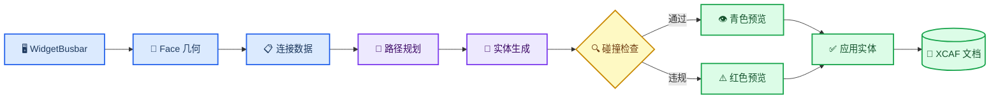

# Sheet Metal Connector 内部实现

_基础版开发说明，对应提交 `a4c55fc`，更新日期：2026-10-22。_

---

## 📋 范围与命名

Sheet Metal Connector 用一段带宽度和厚度的路径钣金连接两个模型 Face。界面已经使用“钣金连接”，内部仍保留 `WidgetBusbar` 和 `widget_busbar.*` 文件名，以避免无关重命名扩大改动范围。

基础版包含 Face/Point 拾取、正交路径、圆弧折弯、Weld/BoltNut 端部、预览、碰撞检查和 XCAF 写入。自动避障、保存后重新编辑、展开及制造补偿不在当前范围内。

## 🏗️ 总体架构

| 组件 | 职责 |
| --- | --- |
| `WidgetBusbar` | UI 状态、拾取会话、预览、Apply/Clear 和数据传递 |
| `SheetMetalConnectorModel.h` | 端点、连接方式、折弯、路径和全局参数 |
| `SheetMetalFaceGeometry` | Face 内默认点、点投影和有方向的法向 |
| `SheetMetalRoutePlanner` | 六种正交路径候选及排序 |
| `SheetMetalConnectorBuilder` | 圆角中心线、矩形扫掠和 Bolt/Nut 孔 |
| `SheetMetalCollisionChecker` | 包围盒初筛、精确干涉、间隙和允许接触区 |
| `ViewerWidget::displayShape` | XCAF 写入、显示注册和模型树集成 |

## 📍 Face 与 Point 拾取

Face 选择与 Point 选择承担不同职责。

### Face 选择

1. `startPicking()` 临时只启用 `TopAbs_FACE` 过滤器。
2. `onObjectSelected()` 取得子 Face 和父 `AIS_InteractiveObject`。
3. 将父对象 `LocalTransformation()` 与 Face Location 合成，保证 Face、端点、目标 Shape、预览和碰撞检查都使用世界坐标。
4. `centerPointAndNormal()` 通过 `BRepGProp::SurfaceProperties` 计算面积中心，再投影到底层曲面。
5. `BRepClass_FaceClassifier` 只接受位于裁剪 Face 内部或边界上的点。
6. 对带孔或凹形 Face，如果中心投影不在 Face 内，则在 UV 范围执行 `11 x 11` 采样，选择距离面积中心最近的有效点。
7. `GeomLProp_SLProps` 在有效点计算法向；Face 为 `TopAbs_REVERSED` 时反转法向。

### Point 选择

`Pick Start Point` 和 `Pick End Point` 读取 `StdSelect_ViewerSelector3d::PickedPoint(1)` 的真实命中点，确认仍是之前的 Face，再投影回裁剪 Face。这个操作只修改 `position`，不会覆盖 Face 和 normal。

因此，视图平面上的 `V3d_View::Convert()` 坐标不会再被误认为 Face 命中点。

## 📚 数据模型

`SheetMetalConnectorData` 保存完整构建输入：

- `start`、`end`：世界坐标点、Face 法向、选中 Face、目标 Shape、目标 Label 和连接参数
- `routePoints`：有顺序的端点与折弯点，每个中间点保存折弯半径
- `width`、`thickness`：矩形截面尺寸
- `clearance`：与非接触障碍物的最小间隙
- `upDirection`：确定初始矩形截面朝向的参考方向

`SheetMetalJointType` 与 `SheetMetalBend` 相互独立。Weld 保存焊接类型索引；BoltNut 保存规格索引和孔数量。当前基础生成器每个 BoltNut 端部只生成一个中心孔。

## 🧭 路径规划

`computeOrthogonalRoute()` 枚举 X、Y、Z 移动顺序的六种排列，并删除连续重复点，因此结果可能是直线、L 形或三轴路径。

候选路径按以下顺序比较：

1. 端点法向对齐程度更高
2. 路径点更少，即折弯更少
3. 折线总长度更短

对齐分数为“首段方向点乘起点法向”减去“末段方向点乘终点法向”。基础版规划器不使用障碍物信息，而是在实体生成后报告碰撞。

## 🔧 实体生成

`SheetMetalConnectorBuilder::build()` 的主要步骤：

1. 校验宽度、厚度和路径点数量。
2. 对每个非共线中间点计算切线入口、出口和圆弧；切线偏移为 `radius * tan(angle / 2)`。折弯半径占满相邻直线段时拒绝生成。
3. 使用首段方向和 `upDirection` 建立中心对齐的矩形截面，通过 `BRepOffsetAPI_MakePipe` 和 corrected Frenet 沿圆角 Wire 扫掠。
4. 对 BoltNut 端部沿 Face normal 切圆柱孔；M6、M8、M10、M12 当前对应 `3.3`、`4.5`、`5.5`、`6.5` mm 孔半径。

返回结果同时包含中心线 Wire 和最终 Shape。失败时返回错误文本，不保留部分有效实体。

## 🔍 碰撞与间隙

`SheetMetalCollisionChecker::check()` 在世界坐标中处理场景对象：

1. 创建连接件包围盒，并按 `clearance` 扩张。
2. 排除连接件自身和上一次 Apply 的实体。
3. 对两个目标 Shape，在端点处减去球形允许接触区；半径为 `max(width, thickness) + clearance`。
4. 用包围盒排除远处对象。
5. 用 `BRepAlgoAPI_Common` 判断实体相交。
6. 未相交时，用 `BRepExtrema_DistShapeShape` 判断最小间隙。

合法结果显示青色；碰撞或间隙不足显示红色，默认阻止 Apply，除非用户明确允许带警告应用。

## 🔄 Preview 与 Apply

Preview 使用临时 `AIS_Shape`。Apply 会重新构建和重新检查最终实体，删除旧的已应用连接件，再调用 `ViewerWidget::displayShape()`。返回的 `TDF_Label` 写入名称 `Sheet Metal Connector` 和 `TDataStd_Comment` 元数据。

元数据包含宽度、厚度、间隙、端点坐标与法向、连接参数、目标 Label Entry、路径点和折弯半径。当前只负责写入，尚未实现重新打开后解析回 UI。

## ⚠️ 当前限制

- 路径规划不会自动绕开障碍物，只在生成后报告碰撞
- 允许接触区使用球形近似，不是精确 Face 接触区域
- 已保存 `holeCount`，但当前每端只生成一个中心孔
- Weld 保存参数，但不生成焊缝实体
- 元数据当前只写不读
- 模型拓扑变化后，Face 引用仍需要稳定的子 Shape 命名策略
- 当前扫掠实体不是带展开/K-factor 的制造级钣金定义

## 🧪 验证范围

`SheetMetalConnectorTests` 已覆盖直线路径、折弯路径、BoltNut 孔、过大折弯半径、相交/远离障碍物、Face 内默认点，以及带 Location 的 Face 返回世界坐标点。

仍需 GUI 手动验收：

- 平面、曲面、凹面及变换后零件的默认点与 Point 覆盖
- 重复 Preview、Clear、Apply 和再次 Apply
- 目标端允许接触与目标其他区域非法穿透的区别
- 保存、重新打开、参数恢复、STEP 导出与重新导入

## 🔗 源码索引

- UI：`src/ui/widget_busbar.h/.cpp/.ui`
- 数据模型：`src/ui/SheetMetalConnectorModel.h`
- Face 几何：`src/ui/SheetMetalFaceGeometry.h/.cpp`
- 路径：`src/ui/SheetMetalRoutePlanner.h/.cpp`
- 实体：`src/ui/SheetMetalConnectorBuilder.h/.cpp`
- 碰撞：`src/ui/SheetMetalCollisionChecker.h/.cpp`
- 测试：`tests/SheetMetalConnectorTests.cpp`
- 多语言：`resource/i18n/qt_occ_en.ts`、`qt_occ_zh.ts`、`qt_occ_ja.ts`
