# Sheet Metal Connector 内部実装

_基本版の開発者向け説明。コミット `a4c55fc`、更新日：2026-10-22。_

---

## 📋 対象範囲と命名

Sheet Metal Connectorは、選択した2つのFaceを幅と厚さを持つ経路板金で接続します。UIとソース識別子は、汎用的なSheet Metal Connector名称に統一されています。

基本版はFace/Point選択、直交経路、円弧曲げ、Weld/BoltNut端部、プレビュー、干渉確認、XCAF登録、現在のドキュメント内でのパラメータ復元を実装しています。自動回避、ネイティブドキュメント永続化、展開、製造補正は対象外です。

## 🏗️ 全体構成

```mermaid
flowchart LR
    accTitle: 板金コネクタ内部構成
    accDescr: 対話選択から経路計算、形状生成、干渉確認、プレビュー、XCAF登録までの主要データフロー

    ui[🖥️ WidgetSheetMetalConnector] --> face_geometry[📐 Face処理]
    face_geometry --> model[📋 接続データ]
    model --> route_planner[🧭 経路計算]
    route_planner --> builder[🔧 形状生成]
    builder --> collision_checker{🔍 干渉確認}
    collision_checker -->|有効| preview[👁️ シアン表示]
    collision_checker -->|違反| warning[⚠️ 赤色表示]
    preview --> apply[✅ 形状を適用]
    warning --> apply
    apply --> xcaf[(💾 XCAF文書)]

    classDef input fill:#dbeafe,stroke:#2563eb,stroke-width:2px,color:#1e3a5f
    classDef geometry fill:#ede9fe,stroke:#7c3aed,stroke-width:2px,color:#3b0764
    classDef decision fill:#fef9c3,stroke:#ca8a04,stroke-width:2px,color:#713f12
    classDef output fill:#dcfce7,stroke:#16a34a,stroke-width:2px,color:#14532d

    class ui,face_geometry,model input
    class route_planner,builder geometry
    class collision_checker decision
    class preview,warning,apply,xcaf output
```

| コンポーネント | 役割 |
| --- | --- |
| `WidgetSheetMetalConnector` | UI状態、選択セッション、プレビュー、Apply/Clear、データ受け渡し |
| `SheetMetalConnectorModel.h` | 端点、接合方法、曲げ、経路、共通パラメータ |
| `SheetMetalFaceGeometry` | Face内の既定点、点投影、向き付き法線 |
| `SheetMetalRoutePlanner` | 6種類の直交候補と順位付け |
| `SheetMetalConnectorBuilder` | 円弧中心線、矩形スイープ、Bolt/Nut穴 |
| `SheetMetalCollisionChecker` | 境界箱の一次判定、交差、クリアランス、許容接触領域 |
| `ViewerWidget::displayShape` | XCAF登録、表示登録、モデルツリー統合 |

## 📍 FaceとPointの選択

Face選択とPoint選択は役割を分離しています。

### Face選択

1. `startPicking()` は一時的に `TopAbs_FACE` フィルタだけを有効にします。
2. `onObjectSelected()` は選択サブFaceと親 `AIS_InteractiveObject` を取得します。
3. 親の `LocalTransformation()` とFace Locationを合成し、Face、端点、対象Shape、プレビュー、干渉確認を同じワールド座標にそろえます。
4. `centerPointAndNormal()` は `BRepGProp::SurfaceProperties` で面積重心を計算し、基底曲面へ投影します。
5. `BRepClass_FaceClassifier` により、トリムされたFaceの内部または境界上にある点だけを採用します。
6. 穴付きFaceや凹Faceで重心投影が外側になる場合、UV範囲を `11 x 11` でサンプリングし、重心に最も近い有効点を選びます。
7. `GeomLProp_SLProps` で法線を計算し、Faceが `TopAbs_REVERSED` の場合は反転します。

### Point選択

`Pick Start Point` と `Pick End Point` は `StdSelect_ViewerSelector3d::PickedPoint(1)` の実ヒット点を取得します。以前選択したFaceと同じであることを確認し、そのトリムFaceへ再投影します。変更するのは `position` だけで、Faceとnormalは保持されます。

これにより、`V3d_View::Convert()` が返すビュープレーン座標をFace上の実点として扱う問題を避けています。

## 📚 データモデル

`SheetMetalConnectorData` は次の入力を保持します。

- `start`、`end`：ワールド座標点、Face法線、選択Face、対象Shape、対象Label、接合パラメータ
- `routePoints`：順序付き端点と曲げ点、および各曲げ半径
- `width`、`thickness`：矩形断面寸法
- `clearance`：非接触障害物までの必要距離
- `upDirection`：初期断面方向の基準

`SheetMetalJointType` と `SheetMetalBend` は独立しています。Weldは溶接種類のインデックス、BoltNutは仕様インデックスと穴数を保持します。現在の基本ビルダーはBoltNut端部ごとに中央穴を1個生成します。

## 🧭 経路計算

`computeOrthogonalRoute()` はX、Y、Z移動順序の6通りを生成し、連続する重複点を削除します。そのため、結果は直線、L字、または3軸経路になります。

候補の優先順位は次の通りです。

1. 端点法線との整合が高い
2. 経路点が少なく、曲げ数が少ない
3. 折れ線全長が短い

整合値は「最初のセグメント方向・始点法線の内積」から「最後のセグメント方向・終点法線の内積」を引いた値です。基本版では障害物を経路探索に使用せず、形状生成後に干渉を報告します。

## 🔧 形状生成

`SheetMetalConnectorBuilder::build()` の処理：

1. 幅、厚さ、経路点数を検証します。
2. 非共線の中間点ごとに接線入口、出口、円弧を作ります。接線オフセットは `radius * tan(angle / 2)` で、半径が隣接直線を消費する場合は失敗します。
3. 最初の経路方向と `upDirection` から中央配置の矩形断面を作り、`BRepOffsetAPI_MakePipe` のcorrected Frenetで円弧Wireに沿ってスイープします。
4. BoltNut端部ではFace normal方向に円柱穴を切ります。M6、M8、M10、M12は現在それぞれ半径 `3.3`、`4.5`、`5.5`、`6.5` mmです。

結果は中心線Wireと最終Shapeを返します。失敗時は部分形状を残さず、エラーテキストを返します。

## 🔍 干渉とクリアランス

`SheetMetalCollisionChecker::check()` はワールド座標で次を実行します。

1. コネクタの境界箱を作り、`clearance` 分だけ拡張します。
2. コネクタ自身と前回ApplyしたShapeを除外します。
3. 2つの対象Shapeから端点中心の球形許容接触領域を除きます。半径は `max(width, thickness) + clearance` です。
4. 境界箱が重ならない障害物を除外します。
5. `BRepAlgoAPI_Common` で実交差を確認します。
6. 交差がない場合は `BRepExtrema_DistShapeShape` で最小距離を確認します。

有効な結果はシアン、交差またはクリアランス違反は赤で表示します。警告付き適用を明示的に許可しない限り、Applyは停止します。

## 🔄 PreviewとApply

Previewは一時的な `AIS_Shape` です。Apply時には形状を再生成・再確認し、前回の適用Shapeがあれば削除してから `ViewerWidget::displayShape()` を呼びます。返された `TDF_Label` に `Sheet Metal Connector` 名と `TDataStd_Comment` メタデータを設定します。

`version=2` メタデータには幅、厚さ、クリアランス、断面方向、端点座標と法線、接合パラメータ、対象Label Entry、経路点、曲げ半径を保存し、`version=1` の読み込みにも対応します。生成済みコネクターを選択してからツールを開くと、パラメータ、経路、両方の親Shape/Label参照を復元し、次のApplyで選択したコネクターを置換します。

安定したサブFace識別子はまだ保存しません。復元した座標と法線は使用できますが、接続点を変更する前に対応するFaceを再選択する必要があります。

## ⚠️ 現在の制限

- 経路計算は障害物を自動回避せず、生成後に報告します
- 許容接触領域は球形近似で、厳密なFace接触領域ではありません
- `holeCount` は保存しますが、現在は各端部に中央穴を1個だけ作ります
- Weldパラメータは保存しますが、溶接ビードShapeは作りません
- 現在のXCAFドキュメント内では復元できますが、ネイティブドキュメントの保存・再オープンは未対応です
- トポロジ変更後のFace参照には安定したサブShape命名が必要です
- 現在のスイープShapeは展開やK-factorを持つ製造用板金定義ではありません

## 🧪 検証範囲

`SheetMetalConnectorTests` は直線経路、曲げ経路、BoltNut穴、過大曲げ半径、交差/遠方障害物、Face内の既定点、Location付きFaceのワールド座標点、メタデータの往復と不正入力拒否を確認します。

GUIでは次を手動確認する必要があります。

- 平面、曲面、凹Face、変換済み部品での既定点とPoint上書き
- Preview、Clear、Apply、再Applyの繰り返し
- 対象端の許容接触と、対象Shapeの別領域への不正侵入の区別
- 保存、再オープン、パラメータ復元、STEP出力と再読み込み

## 🔗 ソース一覧

- UI：`src/ui/widget_sheet_metal_connector.h/.cpp/.ui`
- データモデル：`src/ui/SheetMetalConnectorModel.h`
- メタデータ：`src/ui/SheetMetalConnectorMetadata.h/.cpp`
- Face処理：`src/ui/SheetMetalFaceGeometry.h/.cpp`
- 経路：`src/ui/SheetMetalRoutePlanner.h/.cpp`
- 形状生成：`src/ui/SheetMetalConnectorBuilder.h/.cpp`
- 干渉確認：`src/ui/SheetMetalCollisionChecker.h/.cpp`
- テスト：`tests/SheetMetalConnectorTests.cpp`
- UI翻訳：`resource/i18n/qt_occ_en.ts`、`qt_occ_zh.ts`、`qt_occ_ja.ts`
