# Sheet Metal Connector 内部実装

_基本版の開発者向け説明。コミット `a4c55fc`、更新日：2026-10-23。_

---

## 📋 対象範囲と命名

Sheet Metal Connectorは、選択した2つのFaceを幅と厚さを持つ経路板金で接続します。UIとソース識別子は、汎用的なSheet Metal Connector名称に統一されています。

現在の実装はFace/Point選択、始点Face平面経路、円弧曲げ、ノード単位のBend/Weld/BoltNut遷移、プレビュー、干渉確認、XCAF登録、現在のドキュメント内でのパラメータ復元を実装しています。Auto Calculateは干渉する基本経路を拒否しますが、完全な迂回探索、ネイティブドキュメント永続化、展開、製造補正は対象外です。

## 🏗️ 全体構成

```mermaid
flowchart LR
    accTitle: 板金コネクタ内部構成
    accDescr: 対話選択から経路計算、形状生成、干渉確認、プレビュー、XCAF登録までの主要データフロー

    ui[🖥️ WidgetSheetMetalConnector] --> face_geometry[📐 Face処理]
    face_geometry --> model[📋 接続データ]
    model --> route_planner[🧭 経路計算]
    route_planner --> builder[🔧 形状生成]
    builder --> collision_checker{🔍 干渉確認}
    collision_checker -->|有効| preview[👁️ シアン表示]
    collision_checker -->|違反| warning[⚠️ 赤色表示]
    preview --> apply[✅ 形状を適用]
    warning --> apply
    apply --> xcaf[(💾 XCAF文書)]

    classDef input fill:#dbeafe,stroke:#2563eb,stroke-width:2px,color:#1e3a5f
    classDef geometry fill:#ede9fe,stroke:#7c3aed,stroke-width:2px,color:#3b0764
    classDef decision fill:#fef9c3,stroke:#ca8a04,stroke-width:2px,color:#713f12
    classDef output fill:#dcfce7,stroke:#16a34a,stroke-width:2px,color:#14532d

    class ui,face_geometry,model input
    class route_planner,builder geometry
    class collision_checker decision
    class preview,warning,apply,xcaf output
```

| コンポーネント | 役割 |
| --- | --- |
| `WidgetSheetMetalConnector` | UI状態、選択セッション、プレビュー、Apply/Clear、データ受け渡し |
| `SheetMetalConnectorModel.h` | 端点、接合方法、曲げ、経路、共通パラメータ |
| `SheetMetalFaceGeometry` | Face内の既定点、点投影、向き付き法線 |
| `SheetMetalRoutePlanner` | 始点Face平面経路、重複点削除、検証コールバック |
| `SheetMetalRouteEvaluator` | 経路の妥当性、長さ、曲げ数、横曲げ数の集計 |
| `SheetMetalConnectorBuilder` | 円弧中心線、矩形スイープ、Bolt/Nut穴 |
| `SheetMetalObstacleMap` | シーンShapeの抽出、除外、許容接触の切り取り、境界箱検索 |
| `SheetMetalCollisionChecker` | 境界箱の一次判定、交差、クリアランス、許容接触領域 |
| `ViewerWidget::displayShape` | XCAF登録、表示登録、モデルツリー統合 |

## 📍 FaceとPointの選択

Face選択とPoint選択は役割を分離しています。

### Face選択

1. `startPicking()` は一時的に `TopAbs_FACE` フィルタだけを有効にします。
2. `onObjectSelected()` は選択サブFaceと親 `AIS_InteractiveObject` を取得します。
3. 親の `LocalTransformation()` とFace Locationを合成し、Face、端点、対象Shape、プレビュー、干渉確認を同じワールド座標にそろえます。
4. `centerPointAndNormal()` は `BRepGProp::SurfaceProperties` で面積重心を計算し、基底曲面へ投影します。
5. `BRepClass_FaceClassifier` により、トリムされたFaceの内部または境界上にある点だけを採用します。
6. 穴付きFaceや凹Faceで重心投影が外側になる場合、UV範囲を `11 x 11` でサンプリングし、重心に最も近い有効点を選びます。
7. `GeomLProp_SLProps` で法線を計算し、Faceが `TopAbs_REVERSED` の場合は反転します。

### Point選択

`Pick Start Point` と `Pick End Point` は `StdSelect_ViewerSelector3d::PickedPoint(1)` の実ヒット点を取得します。以前選択したFaceと同じであることを確認し、そのトリムFaceへ再投影します。変更するのは `position` だけで、Faceとnormalは保持されます。

これにより、`V3d_View::Convert()` が返すビュープレーン座標をFace上の実点として扱う問題を避けています。

## 📚 データモデル

`SheetMetalConnectorData` は次の入力を保持します。

- `start`、`end`：ワールド座標点、Face法線、選択Face、対象Shape、対象Label、接合パラメータ
- `routePoints`：順序付き端点と内部ノード。各内部ノードがBend、Weld、BoltNutの遷移方式とパラメータを保持
- `width`、`thickness`：矩形断面寸法
- `clearance`：非接触障害物までの必要距離
- `maximumBendCount`、`allowSideBends`：各連続板金に適用する製造制約
- `upDirection`：旧メタデータ互換用。厳格な基本モードでは `start.normal` から断面を決定

`SheetMetalJointType` と `SheetMetalBend` は独立しています。Weldは溶接種類のインデックス、BoltNutは仕様インデックスと穴数を保持します。現在の基本ビルダーはBoltNut端部ごとに中央穴を1個生成します。

## 🎯 ノード単位の遷移モデル

現在の実装では、隣接する経路点間の各エッジを板セグメントとして扱い、各内部ノードに独立した遷移方式を設定します。

- `Bend`：両側のセグメントを1枚の連続した板金および1つのSolidとして生成
- `Weld`：ノードで2つの板金Solidに分割し、選択した溶接形状を生成
- `BoltNut`：ノードで2つの板金Solidに分割し、必要な重なり、穴、締結接続を生成
- 始点と終点の接続は内部遷移から分離し、生成した板金チェーンを選択対象Shapeへ接続

基本経路は始点Faceのローカル平面を使用します。始点を `S`、終点を `E`、始点法線を `N` とすると、投影点は `Q = E - N * dot(E - S, N)`、基本候補経路は `S → Q → E` です。長さ0のセグメントは削除します。`Q` がBendの場合は1枚の曲げ板金、WeldまたはBoltNutの場合は2枚の接続板金を生成します。追加した内部ノードの既定値はBendです。最大曲げ数は連続する板金ごとに評価し、Bend以外の遷移後にリセットします。

基本版は厳格な非ねじり規則を適用します。最初のセグメントはStart Face平面内に置き、板厚方向を `start.normal` に固定します。最後のセグメントはEnd Face平面内に置き、各Bendで搬送した最終板厚方向を `end.normal` と平行または反平行にする必要があります。平面板全体の斜め配置は許可しますが、矩形断面を経路に沿ってねじる必要がある場合は、歪んだSolidを作らずに拒否します。

## 🧭 経路計算

`computeOrthogonalRoute()` は始点Faceの平面を使い、上記の `S → Q → E` 候補経路を生成します。連続する重複点は削除します。Auto Calculateは、端点の平面方向、最終断面方向、干渉、またはクリアランスのいずれかが不正な候補を拒否します。方向補正ノードや迂回ノードはまだ自動追加しません。

自動生成した1つの角が曲げ回数0または横曲げ禁止条件に違反する場合、そのノードの既定遷移はWeldになります。手動追加ノードはBendが既定値で、選択した経路ノードのパネルから個別に変更できます。

## 🔧 形状生成

`SheetMetalConnectorBuilder::build()` の処理：

1. 幅、厚さ、経路点、製造オプション、始終端セグメントのFace平面制約、最終断面法線を検証します。
2. Bendノードを介する連続セグメントを1枚の板金にまとめます。WeldまたはBoltNutノードで現在の板金を終了し、次の独立Solidを開始します。連続板金が `maximumBendCount` を超える場合や禁止された横曲げを含む場合は、ノード遷移の変更が必要です。
3. 各板金に残る曲げを円弧化し、曲げ半径と隣接直線長を検証します。
4. Start normalとBendで搬送した断面フレームから各板金を独立して掃引します。Start normalが最初のセグメントと不整合な場合に任意の代替軸へ切り替える処理は行いません。複数の場合は1つのCompoundに格納します。
5. 直線Butt接合は同じ切断位置を共有します。Lap WeldとBoltNutは経路方向に `max(10 mm, 2 × thickness)` だけ重ね、隣接する板金を隣接する板厚層へ配置します。両者は面で接触し、Solid体積は交差しません。BoltNutは両方に整列した穴を作ります。角部Butt Weldは共通のマイター面で切り、交差体積を除去します。
6. BoltNut端部ではFace normal方向に円柱穴を切ります。M6、M8、M10、M12は現在それぞれ半径 `3.3`、`4.5`、`5.5`、`6.5` mmです。

結果は中心線Wireと最終Shapeを返します。失敗時は部分形状を残さず、エラーテキストを返します。

## 🔍 干渉とクリアランス

`SheetMetalObstacleMap` は対応するシーンオブジェクトをワールド座標のShapeへ変換し、除外規則と許容接触規則を適用して境界箱を保持します。`SheetMetalCollisionChecker::check()` はその障害物マップを検索して、次の精密判定を実行します。

1. コネクタの境界箱を作り、`clearance` 分だけ拡張します。
2. コネクタ自身と前回ApplyしたShapeを除外します。
3. 2つの対象Shapeから端点中心の球形許容接触領域を除きます。半径は `max(width, thickness) + clearance` です。
4. 境界箱が重ならない障害物を除外します。
5. `BRepAlgoAPI_Common` で実交差を確認します。
6. 交差がない場合は `BRepExtrema_DistShapeShape` で最小距離を確認します。

有効な結果はシアン、交差またはクリアランス違反は赤で表示します。警告付き適用を明示的に許可しない限り、Applyは停止します。

## 🔄 PreviewとApply

Previewは一時的な `AIS_Shape` です。Apply時には形状を再生成・再確認し、前回の適用Shapeがあれば削除してから `ViewerWidget::displayShape()` を呼びます。返された `TDF_Label` に `Sheet Metal Connector` 名と `TDataStd_Comment` メタデータを設定します。

`version=5` メタデータは各ノードの遷移方式とBend/Weld/BoltNutパラメータを保存し、`version=1` から `version=4` の読み込みにも対応します。旧版のグローバル中間接続は、分割が必要な経路ノードへ移行します。生成済みコネクターを選択してからツールを開くと、パラメータ、経路、両方の親Shape/Label参照を復元し、次のApplyで選択したコネクターを置換します。

安定したサブFace識別子はまだ保存しません。復元した座標と法線は使用できますが、接続点を変更する前に対応するFaceを再選択する必要があります。

## ⚠️ 現在の制限

- Auto Calculateは始点Face平面の経路を検証しますが、障害物を迂回する新しい経路点はまだ探索しません
- 許容接触領域は球形近似で、厳密なFace接触領域ではありません
- `holeCount` は保存しますが、現在は各端部に中央穴を1個だけ作ります
- BoltNutは角で分割した板金を直接接続できません。この場合は今後のアングルブラケットまたはフランジが必要です
- Weldパラメータは保存しますが、溶接ビードShapeは作りません
- Lap Weldは現在 `max(10 mm, 2 × thickness)` だけ経路を対象側へ延長します。Phase 2で端面接触か重なりかを再検討し、必要なパラメータを公開します
- 曲げ半径は矩形断面の半対角線より大きくする必要があり、スイープの自己交差と浮いた円弧Faceを防止します
- 現在のXCAFドキュメント内では復元できますが、ネイティブドキュメントの保存・再オープンは未対応です
- トポロジ変更後のFace参照には安定したサブShape命名が必要です
- 現在のスイープShapeは展開やK-factorを持つ製造用板金定義ではありません

## 🧪 検証範囲

`SheetMetalConnectorTests` のソースには、厳格なStart/End Face平面整合、最終板厚法線の不一致拒否、始点Face平面投影、単一/複数板金経路、ノード単位の遷移、直線BoltNut接合、マイター角Weld、未対応のBolt角接合、曲げ半径、干渉、Face形状、メタデータ互換性のケースを追加しています。ユーザー指定により、今回の厳格姿勢変更はビルドおよびテスト実行を行っていません。

GUIでは次を手動確認する必要があります。

- 平面、曲面、凹Face、変換済み部品での既定点とPoint上書き
- Preview、Clear、Apply、再Applyの繰り返し
- 対象端の許容接触と、対象Shapeの別領域への不正侵入の区別
- 保存、再オープン、パラメータ復元、STEP出力と再読み込み

## 🔗 ソース一覧

- UI：`src/ui/widget_sheet_metal_connector.h/.cpp/.ui`
- データモデル：`src/ui/SheetMetalConnectorModel.h`
- メタデータ：`src/ui/SheetMetalConnectorMetadata.h/.cpp`
- Face処理：`src/ui/SheetMetalFaceGeometry.h/.cpp`
- 経路：`src/ui/SheetMetalRoutePlanner.h/.cpp`
- 経路評価：`src/ui/SheetMetalRouteEvaluator.h/.cpp`
- 形状生成：`src/ui/SheetMetalConnectorBuilder.h/.cpp`
- 障害物マップ：`src/ui/SheetMetalObstacleMap.h/.cpp`
- 干渉確認：`src/ui/SheetMetalCollisionChecker.h/.cpp`
- テスト：`tests/SheetMetalConnectorTests.cpp`
- UI翻訳：`resource/i18n/qt_occ_en.ts`、`qt_occ_zh.ts`、`qt_occ_ja.ts`
