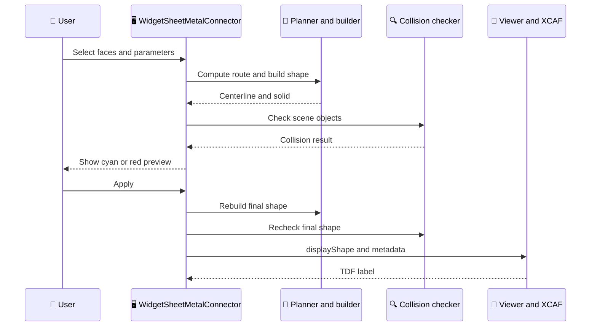

# Sheet Metal Connector internal implementation

_Developer guide for the base implementation in commit `a4c55fc`, updated 2026-10-22._

---

## 📋 Scope and naming

Sheet Metal Connector creates one routed sheet-metal shape between two selected faces. The UI and source identifiers use the same general-purpose name.

The base implementation covers face and point selection, orthogonal route planning, rounded bends, Weld/BoltNut endpoint settings, preview, collision checks, XCAF insertion, and in-document parameter reload. Automatic obstacle avoidance, native document persistence, unfolding, and manufacturing compensation are outside this version.

## 🏗️ Architecture

```mermaid
flowchart LR
    accTitle: Sheet Metal Connector Architecture
    accDescr: Main data flow from interactive face selection through route planning, solid generation, collision validation, preview, and XCAF insertion

    ui[🖥️ WidgetSheetMetalConnector] --> face_geometry[📐 Face geometry]
    face_geometry --> model[📋 Connector data]
    model --> route_planner[🧭 Route planner]
    route_planner --> builder[🔧 Connector builder]
    builder --> collision_checker{🔍 Collision check}
    collision_checker -->|Acceptable| preview[👁️ Cyan preview]
    collision_checker -->|Violation| warning[⚠️ Red preview]
    preview --> apply[✅ Apply shape]
    warning --> apply
    apply --> xcaf[(💾 XCAF document)]

    classDef input fill:#dbeafe,stroke:#2563eb,stroke-width:2px,color:#1e3a5f
    classDef geometry fill:#ede9fe,stroke:#7c3aed,stroke-width:2px,color:#3b0764
    classDef decision fill:#fef9c3,stroke:#ca8a04,stroke-width:2px,color:#713f12
    classDef output fill:#dcfce7,stroke:#16a34a,stroke-width:2px,color:#14532d

    class ui,face_geometry,model input
    class route_planner,builder geometry
    class collision_checker decision
    class preview,warning,apply,xcaf output
```

| Component | Responsibility |
| --- | --- |
| `WidgetSheetMetalConnector` | UI state, pick sessions, preview, Apply/Clear, and data transfer |
| `SheetMetalConnectorModel.h` | Endpoint, joint, bend, route, and global parameter structures |
| `SheetMetalFaceGeometry` | Face-inside default point, point projection, and oriented normal |
| `SheetMetalRoutePlanner` | Six orthogonal route candidates and candidate ranking |
| `SheetMetalConnectorBuilder` | Rounded centerline, rectangular sweep, and Bolt/Nut holes |
| `SheetMetalCollisionChecker` | Broad phase, exact intersection, clearance, and allowed contact |
| `ViewerWidget::displayShape` | XCAF insertion, display registration, and model-tree integration |

## 📍 Face and point selection

Face selection and point selection intentionally have different responsibilities.

### Face selection

1. `WidgetSheetMetalConnector::startPicking()` temporarily enables only the `TopAbs_FACE` selection filter.
2. `onObjectSelected()` obtains the selected sub-face and its parent `AIS_InteractiveObject`.
3. The parent `LocalTransformation()` is composed with the face location so that the face, endpoint, target shape, preview, and collision checks use world coordinates.
4. `SheetMetalFaceGeometry::centerPointAndNormal()` computes the area center with `BRepGProp::SurfaceProperties` and projects it to the underlying surface.
5. `BRepClass_FaceClassifier` accepts the point only when it is inside or on the trimmed face.
6. If the projected center lies outside a concave or holed face, an `11 x 11` UV sample searches for the valid point closest to the area center.
7. `GeomLProp_SLProps` evaluates the normal at the accepted point. A reversed face orientation reverses the normal.

### Point selection

`Pick Start Point` and `Pick End Point` read `StdSelect_ViewerSelector3d::PickedPoint(1)`, verify that the picked face is the previously stored face, and project the picked point back to that trimmed face. Only `position` changes; the stored face and normal remain unchanged.

This separation prevents the view-plane coordinate returned by `V3d_View::Convert()` from being treated as a real face hit.

## 📚 Data model

`SheetMetalConnectorData` owns the complete build input:

- `start` and `end`: world-space point, face normal, selected face, target shape, target label, and joint data
- `routePoints`: ordered endpoints and bend points, each with its own bend radius
- `width` and `thickness`: rectangular section dimensions
- `clearance`: required distance from non-contact obstacles
- `upDirection`: reference used to orient the initial rectangular section

`SheetMetalJointType` is independent from `SheetMetalBend`. Weld stores a weld-type index; BoltNut stores a specification index and hole count. The base builder currently creates one centered hole per BoltNut endpoint.

## 🧭 Route planning

`SheetMetalRoutePlanner::computeOrthogonalRoute()` builds the six permutations of X, Y, and Z movement. Consecutive duplicate points are removed, so the result can be a straight route, an L route, or a three-axis route.

Candidates are compared in this order:

1. Higher endpoint-normal alignment
2. Fewer route points, therefore fewer bends
3. Shorter total polyline length

The alignment value is the first segment direction dotted with the start normal, minus the final segment direction dotted with the end normal. Collision information is not used during route planning in the base version; it is evaluated after building the candidate solid.

## 🔧 Geometry construction

`SheetMetalConnectorBuilder::build()` performs four steps:

1. Validate positive width and thickness and require at least two route points.
2. Replace every non-collinear interior corner with tangent entry/exit points and a circular arc. The tangent offset is `radius * tan(angle / 2)`; a radius is rejected when it consumes either adjacent segment.
3. Build a centered rectangular profile from the first route direction and `upDirection`, then sweep it along the rounded wire using `BRepOffsetAPI_MakePipe` with corrected Frenet transport.
4. For each BoltNut endpoint, cut a cylinder along the stored face normal. M6, M8, M10, and M12 currently map to hole radii `3.3`, `4.5`, `5.5`, and `6.5` mm.

The result contains both the centerline wire and the final shape. Errors are returned as text instead of leaving a partially valid result.

## 🔍 Collision and clearance logic

`SheetMetalCollisionChecker::check()` evaluates scene objects in world coordinates:

1. Build and enlarge the connector bounding box by the requested clearance.
2. Skip the connector itself and the previously applied connector shape.
3. For the two intended target shapes, subtract a spherical allowed-contact zone centered at the endpoint. Its radius is `max(width, thickness) + clearance`.
4. Reject obstacles whose bounding boxes do not overlap the enlarged connector box.
5. Use `BRepAlgoAPI_Common` to detect real intersection.
6. If there is no intersection, use `BRepExtrema_DistShapeShape` to compare the exact minimum distance with the requested clearance.

An acceptable result is displayed in cyan. Collision or clearance failure is displayed in red and blocks Apply unless the user explicitly enables the warning override.

## 🔄 Preview and Apply sequence

Preview shapes are temporary `AIS_Shape` objects. Apply rebuilds and rechecks the solid, removes the previous applied result when present, and calls `ViewerWidget::displayShape()`. The returned `TDF_Label` receives the name `Sheet Metal Connector` and a `TDataStd_Comment` metadata string.

The `version=2` metadata contains width, thickness, clearance, section direction, endpoint coordinates and normals, joint parameters, target-label entries, and route points with bend radii. The parser remains compatible with `version=1`. When a generated connector is selected before opening the tool, the panel restores these values, resolves both parent Shape/Label references, and marks the selected connector as the result to replace on the next Apply.

The metadata does not store a stable sub-Face identifier. After reload, the saved point and normal remain usable, but changing a point requires reselecting its Face first.

## ⚠️ Limits and extension points

- Route planning reports obstacles after construction; it does not search around them
- Allowed contact uses a spherical approximation rather than an exact face contact region
- `holeCount` is stored but the base builder creates one centered hole
- Weld stores parameters but does not create a weld bead solid
- Reload works inside the current XCAF document; durable native document save/reopen is not yet available
- Topological face references may need a stable sub-shape naming strategy after model changes
- The sweep represents a routed solid, not a manufacturing-grade unfolded sheet-metal definition

Phase 2 should extend the planner and evaluator without merging joint type back into bend type. See [Phase 2 plan](sheet_metal_connector_phase2_plan.md).

## 🧪 Verification

`SheetMetalConnectorTests` covers straight and bent routes, BoltNut construction, oversized bend rejection, intersecting and distant obstacles, a face-inside default point, a transformed face returning a world-space point, and metadata round-trip/rejection.

Manual GUI acceptance should still verify:

- Face default points and optional point overrides on planar, curved, concave, and transformed parts
- Repeated preview, Clear, Apply, and re-Apply behavior
- Intended target contact versus illegal penetration elsewhere on the target part
- Save, reopen, metadata restoration, STEP export, and STEP re-import

## 🔗 Source map

- UI orchestration: `src/ui/widget_sheet_metal_connector.h`, `src/ui/widget_sheet_metal_connector.cpp`, `src/ui/widget_sheet_metal_connector.ui`
- Model: `src/ui/SheetMetalConnectorModel.h`
- Metadata codec: `src/ui/SheetMetalConnectorMetadata.h`, `src/ui/SheetMetalConnectorMetadata.cpp`
- Face geometry: `src/ui/SheetMetalFaceGeometry.h`, `src/ui/SheetMetalFaceGeometry.cpp`
- Route planner: `src/ui/SheetMetalRoutePlanner.h`, `src/ui/SheetMetalRoutePlanner.cpp`
- Builder: `src/ui/SheetMetalConnectorBuilder.h`, `src/ui/SheetMetalConnectorBuilder.cpp`
- Collision checker: `src/ui/SheetMetalCollisionChecker.h`, `src/ui/SheetMetalCollisionChecker.cpp`
- Tests: `tests/SheetMetalConnectorTests.cpp`
- UI translations: `resource/i18n/qt_occ_en.ts`, `qt_occ_zh.ts`, `qt_occ_ja.ts`
